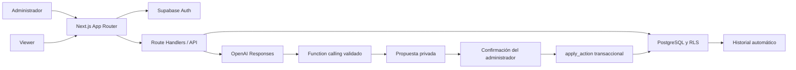

# Arquitectura

## Componentes



Los Server Components protegen `/admin` y `/board`. `proxy.ts` refresca las cookies de sesión; la autorización efectiva se repite en cada endpoint y en PostgreSQL. El navegador nunca decide su rol. El cambio de vista de `/demo` es únicamente una simulación con datos ficticios y no habilita endpoints reales.

## Carpetas

```text
app/
  layout.tsx, globals.css, page.tsx
  demo/page.tsx                 # wireframe navegable aislado
  login/page.tsx
  admin/page.tsx                # dashboard y chat
  board/page.tsx                # lectura
  api/
    login/route.ts, logout/route.ts
    tasks/route.ts              # formulario manual → RPC
    chat/route.ts               # sesión + cuota + function calling
    actions/route.ts            # confirmar propuesta propia
components/
  workspace.tsx                # tablero, métricas, formulario, chat
  login.tsx
lib/
  auth.ts                      # sesión, rol, origen y errores seguros
  domain.ts                    # Zod, estados y métricas
  data.ts                      # lectura autorizada para pantallas
  ai.ts                        # herramientas y bucle limitado
  demo.ts                      # datos ficticios
  supabase/server.ts           # cliente SSR con sesión del usuario
proxy.ts                       # refresco de sesión
supabase/
  migrations/202610190001_initial.sql
  seed.sql                     # catálogos opcionales de ejemplo
tests/
  database.test.ts             # migración/RLS/auditoría/RPC
  domain.test.ts               # reglas y origen
docs/
.github/workflows/ci.yml
.env.example, vercel.json, package-lock.json
```

## Contratos de API

Todas las escrituras requieren un `Origin` idéntico al origen de `APP_ORIGIN`, JSON válido y sesión, excepto login. La app tiene un único origen autorizado por despliegue. No se acepta el origen dinámicamente desde headers de proxy enviados por el cliente. Límite de cuerpo lógico de 20.000 caracteres después de leerlo; para cargas grandes se debe usar Storage, no estos endpoints.

| Ruta                | Entrada                                             | Autorización                      | Resultado                        |
| ------------------- | --------------------------------------------------- | --------------------------------- | -------------------------------- |
| POST `/api/login`   | email, password                                     | Supabase Auth                     | Cookie de sesión                 |
| POST `/api/logout`  | objeto vacío                                        | Sesión actual                     | Cierre de sesión                 |
| POST `/api/tasks`   | kind + task (+ task_id, expected_version si update) | Admin activo                      | taskId; aplica formulario manual |
| POST `/api/chat`    | message ≤ 4.000, sessionId opcional                 | Admin activo, conversación propia | text, proposals, sessionId       |
| POST `/api/actions` | actionId UUID                                       | Admin activo, acción propia       | taskId; confirmación idempotente |

`task` contiene title, context, status, priority, due_date, area_id, business_line_id, project_id, requester_id, assignee_ids. Nullable significa sin asignar, no una cadena vacía. El esquema no acepta campos adicionales como role, created_by o SQL. Una actualización exige la representación completa y la versión leída; el formulario la carga y el asistente debe consultar `get_task` antes de proponerla.

## Function calling

Se usa Responses con `store:false`, herramientas con `strict:true`, `additionalProperties:false`, campos obligatorios (nullable cuando corresponda) y `parallel_tool_calls:false`. Cada llamada recibe una respuesta `function_call_output` vinculada por `call_id`; solo se aceptan herramientas de una lista cerrada. El servidor vuelve a validar con Zod. Basado en la [documentación oficial de function calling](https://developers.openai.com/api/docs/guides/function-calling).

Herramientas: `search_tasks` (máximo 30), `get_task`, `catalogs` (máximo 100 por catálogo), `propose_create` y `propose_update`. No hay SQL libre, borrado, cambios de roles, envío de mensajes externos ni herramientas de red controladas por el modelo. Las propuestas no modifican tareas; quedan en `ai_actions`. El botón Confirmar llama a una RPC que revalida sesión/rol/propiedad/versión/fecha de expiración. Lock de la acción evita doble aplicación y lock de la tarea evita sobrescrituras. Si falla un responsable o una FK, toda la transacción se revierte.

Máximo cuatro llamadas al modelo, 2.500 tokens de salida por llamada y tres propuestas por turno; diez solicitudes/minuto/administrador con contador compartido en PostgreSQL. Cada llamada tiene timeout de 20 segundos y no se reintenta automáticamente. El endpoint admite hasta 120 segundos; ajustarlo al plan de hosting. No hay presupuesto mensual implementado: fijar alertas y límites operativos en la cuenta OpenAI. El modelo es configurable; `gpt-4.1-mini` es un valor inicial por su soporte documentado de [function calling](https://developers.openai.com/api/docs/models/gpt-4.1-mini), sujeto a disponibilidad de la cuenta.

El contexto enviado a OpenAI incluye los últimos 12 mensajes del chat propio y los resultados de las herramientas consultadas. Las tareas y sus contextos se tratan como datos no confiables. Las instrucciones reducen el riesgo de prompt injection, pero el límite de seguridad lo forman los permisos del servidor, RLS, lista de herramientas, validación y revisión humana. `store:false` no constituye una promesa de retención cero del proveedor; revisar las condiciones y configuración de la cuenta antes de introducir información sensible.

## Límites de esta base

- Un espacio de trabajo: acceso transversal a tareas para todos los miembros activos.
- Sin sincronización en tiempo real, arrastre de tarjetas ni notificaciones.
- Dashboard limitado al conjunto de 500 tareas más recientes. Antes de escalar, sustituirlo por agregados y paginación en servidor.
- No se expone UI para reabrir chats/propuestas, aunque se guardan en base. Descartar una tarjeta de propuesta solo la oculta; no cambia su estado. Vence a los 30 minutos.
- Autor de tareas y cambios se deriva de la sesión en la RPC. Comentarios/archivos admiten gestión de metadatos por administradores; al implementar sus endpoints debe fijarse autor desde sesión.
- El registro de auditoría es inmutable para clientes de la app, no frente a un operador de base de datos.
- La demo y las pruebas no envían datos a OpenAI. Hay que completar el piloto integrado con cuentas reales.
