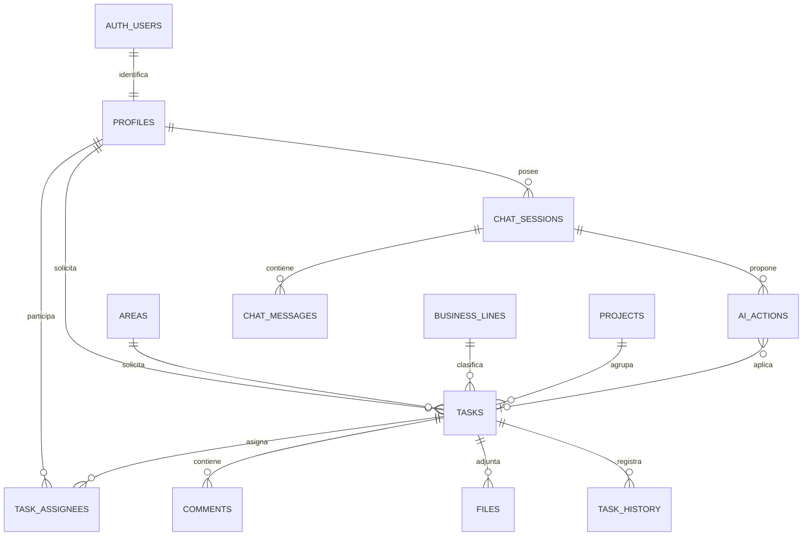

# Modelo y valores por defecto

## Decisiones de partida

Un único espacio privado de Skandia. Idioma español; zona horaria `America/Mexico_City`. Todos los miembros activos pueden consultar todas las tareas y su contexto. Solo administradores pueden modificarlas. No es una implementación multiempresa ni segmenta acceso por área/proyecto. Si se necesita aislamiento por área, debe añadirse antes de cargar datos con ese requisito.

El rol de usuario es independiente de su participación en una tarea: un viewer puede ser responsable o solicitante, aunque no pueda cambiar el estado. Los responsables y solicitantes deben existir como perfiles activos. El solicitante es opcional y único; los responsables son opcionales y múltiples (máximo 20). Usuarios externos sin acceso, contactos libres y equipos como responsables quedan para una ampliación.

Estados: **Backlog → Por hacer → En proceso → En revisión → Finalizadas**. Se permite volver a cualquier estado; al reabrir se limpia `completed_at`. Por defecto: `todo`, prioridad `normal`, sin fecha, sin responsable, sin proyecto y contexto vacío. Prioridades: baja, normal, alta, urgente. Entrega como `date` (día completo); eventos como `timestamptz` UTC. Vencida significa entrega anterior a hoy en CDMX y estado distinto de finalizada; vencer hoy no cuenta como vencida.

Áreas, líneas y proyectos son catálogos independientes, sin inventar una jerarquía oficial. La tarea declara su clasificación explícita; el proyecto no la sobreescribe. `seed.sql` ofrece catálogos de ejemplo opcionales, no oficiales. El formulario permite elegirlos, pero su administración por UI queda pendiente.

## Entidades

| Tabla            | Campos principales                                                                                                               | Relación / propósito                                                             |
| ---------------- | -------------------------------------------------------------------------------------------------------------------------------- | -------------------------------------------------------------------------------- |
| `auth.users`     | id, email, credenciales gestionadas por Auth                                                                                     | Identidad; sin contraseñas en tablas propias                                     |
| `profiles`       | id, display_name, role, active                                                                                                   | 1:1 con Auth. Inactivo y viewer por defecto. Rol gestionado fuera de la app      |
| `areas`          | id, name único                                                                                                                   | Área solicitante                                                                 |
| `business_lines` | id, name único                                                                                                                   | Línea de negocio                                                                 |
| `projects`       | id, name, description, area_id, business_line_id, archived                                                                       | Agrupa tareas                                                                    |
| `tasks`          | id, title, context, status, priority, due_date, area_id, business_line_id, project_id, requester_id, created_by, version, fechas | Unidad operativa; contexto incluye objetivo, entregable, decisiones y aceptación |
| `task_assignees` | task_id + user_id                                                                                                                | N:M tareas–responsables; clave compuesta evita duplicados                        |
| `comments`       | id, task_id, author_id, body, created_at                                                                                         | Comentarios privados para administradores                                        |
| `files`          | id, task_id, uploaded_by, object_path, original_name, mime_type, size_bytes                                                      | Metadatos; binarios en bucket privado `task-files`                               |
| `task_history`   | id, task_id, actor_id, entity, operation, before_data, after_data, created_at                                                    | Auditoría automática; no editable por cliente                                    |
| `chat_sessions`  | id, user_id, title, created_at                                                                                                   | Cada chat pertenece a un administrador                                           |
| `chat_messages`  | id, session_id, role, content, created_at                                                                                        | Mensajes usuario/asistente; contexto reciente para IA                            |
| `ai_actions`     | id, session_id, user_id, payload, status, result_task_id, expires_at                                                             | Propuesta pendiente, aplicada o cancelada; vence en 30 min                       |
| `ai_usage`       | user_id + minute, count                                                                                                          | Límite distribuido de solicitudes de IA                                          |

## Permisos efectivos

| Recurso                                    | Sin sesión / inactivo             | Viewer activo   | Admin activo                                                |
| ------------------------------------------ | --------------------------------- | --------------- | ----------------------------------------------------------- |
| Tareas, contexto, asignaciones y catálogos | Sin acceso                        | Leer            | Leer y modificar por RPC                                    |
| Perfiles básicos                           | Solo perfil propio si autenticado | Leer directorio | Leer directorio                                             |
| Cambiar roles o activar usuarios           | No                                | No              | Solo operador de Supabase; no por API de la app             |
| Comentarios, archivos e historial          | No                                | No              | Leer; comentarios/archivos editables                        |
| Chat y propuestas                          | No                                | No              | Solo conversaciones/propuestas propias                      |
| IA                                         | No                                | No              | Hasta 10 solicitudes/minuto; máximo 4 llamadas modelo/turno |

RLS está activa en todas las tablas. Helpers `is_member`/`is_admin` leen el rol persistido, no metadatos editables del JWT. La aplicación se conecta con la sesión del usuario y una clave publicable, sin acceso privilegiado. Las tareas y asignaciones se escriben mediante `apply_action`; la función vuelve a comprobar rol, propietario, vencimiento y versión dentro de una transacción.

Auditoría de tareas, asignaciones, comentarios y metadatos de archivos. No hay borrado de tareas expuesto. Los perfiles se desactivan conservando referencias históricas. No hay política de borrado/retención automática; definirla al pasar a operación con datos reales. Los contadores de IA requieren limpieza periódica futura.

Archivos: bucket privado, máximo 10 MB, PDF/PNG/JPEG/TXT. No se envían automáticamente a la IA. La carga y descarga, el análisis de contenido y la conciliación entre metadatos y objetos están pendientes de implementación. El nombre del objeto deberá ser UUID y la descarga deberá pasar por la autorización correspondiente; no se deben publicar URLs permanentes.
