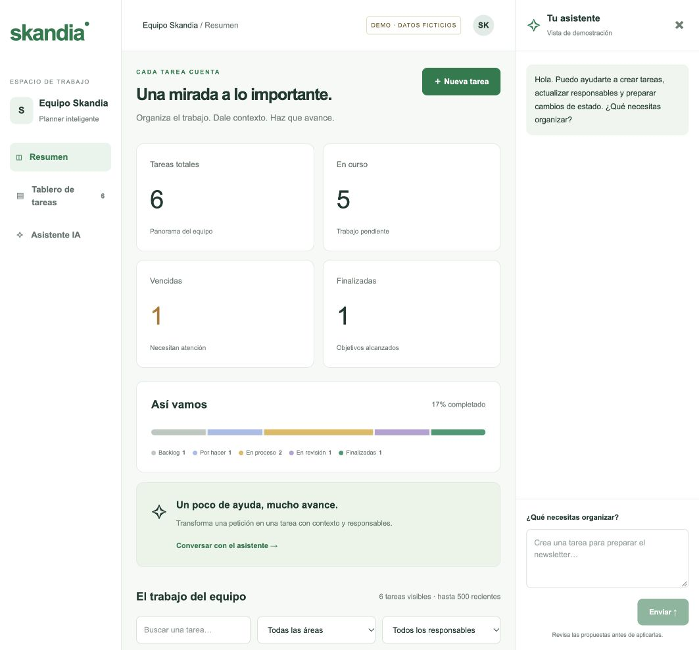
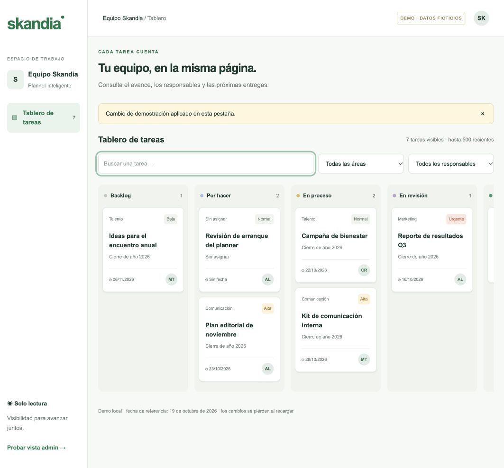

# Pantallas y flujos

La ruta `/demo` es el wireframe navegable con estilo visual inicial: verde, fondos claros, tarjetas y tipografía de sistema. Es una propuesta visual; no utiliza un manual de identidad oficial ni un logotipo descargado.

## Administrador · `/admin`

```text
┌────────────────┬──────────────────────────────────────────┬──────────────────────┐
│ skandia        │ Equipo Skandia / Resumen                 │ ✧ Tu asistente       │
│                ├──────────────────────────────────────────┼──────────────────────┤
│ Equipo Skandia │ Una mirada a lo importante. [Nueva tarea]│ Conversación         │
│                │                                          │                      │
│ ▣ Resumen      │ [Totales] [En curso] [Vencidas] [Hechas] │ “Prepara una tarea…” │
│ ▤ Tablero      │                                          │                      │
│ ✧ Asistente    │ [Distribución por estado] [Ayuda de IA] │ Propuesta            │
│                │                                          │ título / estado      │
│                │ [Buscar] [Área] [Responsable]            │ entrega / responsables│
│                │                                          │ [Confirmar cambio]   │
│                │ Backlog | Por hacer | Proceso | Revisión │                      │
│                │  tarjeta     tarjeta      tarjeta        │ [Mensaje…] [Enviar]  │
│ Administrador  │                | Finalizadas              │                      │
└────────────────┴──────────────────────────────────────────┴──────────────────────┘
```

Los indicadores abarcan las hasta 500 tareas más recientes cargadas. “En curso” incluye todo lo no finalizado. Los filtros afectan al tablero; los indicadores permanecen como resumen del conjunto cargado. El tablero se desplaza horizontalmente para conservar el tamaño de las tarjetas. El chat se puede cerrar; en tablet/móvil se superpone. Los errores se anuncian y se muestran en el espacio de trabajo.

## Consulta · `/board`

```text
┌────────────────┬─────────────────────────────────────────────────────────────┐
│ skandia        │ Tu equipo, en la misma página.                              │
│                │ [Buscar tarea] [Todas las áreas] [Todos los responsables]   │
│ ▤ Tablero      │                                                             │
│                │ Backlog | Por hacer | En proceso | En revisión | Finalizadas│
│                │ [Título]    [Título]     [Título]                            │
│                │ Área · prioridad · entrega · responsables                   │
│ Solo lectura   │                                                             │
└────────────────┴─────────────────────────────────────────────────────────────┘
```

Sin dashboard, chat ni controles para mutar datos. Abrir una tarjeta muestra título, estado, prioridad, fecha, clasificación, solicitante, responsables y contexto en lectura. El contexto es información compartida por diseño; no introducir ahí notas que deban ser exclusivas del administrador.

## Detalle / nueva tarea

```text
┌───────────────────────────────────────────┐
│ Nueva tarea / Editar tarea             [×] │
│ Título                                    │
│ [Estado]              [Prioridad]         │
│ [Fecha de entrega]    [Área]              │
│ [Línea de negocio]    [Proyecto]          │
│ [Solicitante]                              │
│ Responsables: □ Ana □ Carlos □ María      │
│ Contexto                                  │
│ Objetivo / entregable / decisiones /       │
│ criterio de aceptación                    │
│ [Guardar tarea]                           │
└───────────────────────────────────────────┘
```

El panel permite crear/editar manualmente sin usar IA. El viewer ve los mismos datos sin edición. Comentarios, archivos y visor del historial se incorporarán como pestañas en este panel; en esta base se entregan sus tablas y permisos.

## Flujos implementados

1. Manual: nueva tarea → formulario validado → propuesta técnica interna → RPC atómica → historial → refrescar tablero.
2. IA: petición → consultar tareas/catálogos → propuesta visible → revisar campos → confirmar → volver a validar acceso/versión → guardar e historizar.
3. Conflicto: otro administrador modifica la tarea → confirmar propuesta antigua → rechazo → nueva propuesta con datos actualizados.
4. Consulta: sesión válida → tablero → filtros → detalle de lectura. El servidor y PostgreSQL bloquean las escrituras aunque se intente llamar la API directamente.
5. Demo: entrar sin cuenta → probar tarjetas, filtros y formulario → cambios solo de la pestaña. El chat explica que es una demostración.

## Próximas mejoras de producto

- Recuperación de contraseña, invitaciones y administración de miembros.
- Comentarios, archivos e historial visibles en el detalle.
- Paginación y métricas globales en servidor, filtros por proyecto y fechas.
- Recuperación de chats y propuestas pendientes después de recargar.
- Resumen semanal, detección de tareas sin contexto y sugerencias de reparto de carga.
- Después: notificaciones y calendario. No hay automatismos de correo ni cambios sin revisión.

## Capturas verificadas

Administración:



Consulta durante la prueba de creación de tarea:


